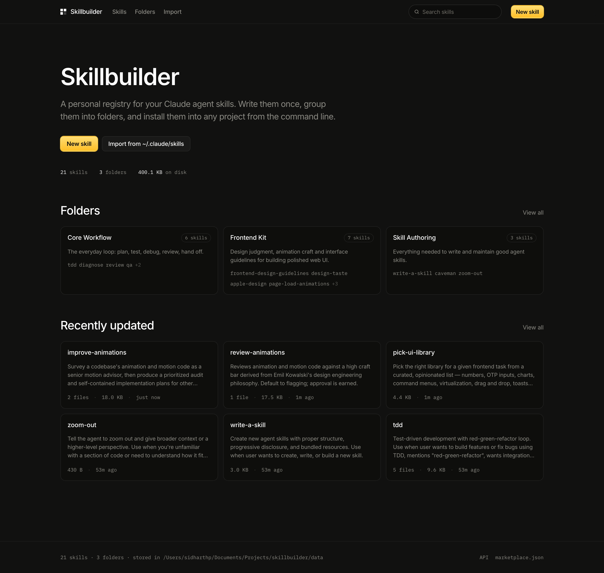

<div align="center">


# Circe

**Your own registry for Claude agent skills, rules and MCP servers.**
Write them in the browser, group them into folders, install a folder into any project with one command.

[](LICENSE)
[](go.mod)



</div>

---

## What this is

[Agent Skills](https://code.claude.com/docs/en/skills) are folders containing a `SKILL.md`
file that teach Claude how to do something. They pile up fast, they live scattered across
machines and repos, and there's no good way to say *"give this project those six skills."*

Circe is a small self-hosted app that fixes that. It holds three kinds of thing, because a
project needs three different things from you:

| | What it is | Where it lands in a project |
| --- | --- | --- |
| **Skills** | A procedure the agent can follow | `./.claude/skills/` |
| **Rules** | How you work, and what to avoid | `CLAUDE.md` / `AGENTS.md` |
| **MCP servers** | A live connection to something outside the repo | `.mcp.json` |

- **Write and edit** in a proper editor, with validation against the real `SKILL.md` rules.
- **Group them into folders.** A folder is the unit you install.
- **Install with one command**: `circe my-folder` drops every skill in it into
  `./.claude/skills/`. `circe rules <folder>` and `circe mcp <folder>` do the same for the
  other two.
- **Import from anywhere**: a repo on any git host (GitHub, GitLab, Bitbucket, Codeberg,
  self-hosted Gitea/Forgejo), a pasted `SKILL.md` or `.mcp.json`, your local
  `~/.claude/skills`, or a share code from someone else's registry. Content is copied in,
  so it stays yours even if the source disappears.
- **A catalog of 32 known MCP servers**, so adding GitHub or Postgres does not start with
  looking up a command line.
- **No database.** Everything is plain files on disk, so the storage directory *is* your
  backup. Commit it to git if you like.

It's two Go binaries and a directory of markdown. That's the whole system.

## Deploy it

### One click

[](https://railway.com/new/template?template=https%3A%2F%2Fgithub.com%2Fsidharthpunathil%2Fcirce)

Set **`CIRCE_PASSWORD`** when prompted, and attach a **volume mounted at `/data`**
so your skills survive redeploys. That's it.

It's cheap to run: the image is ~15 MB, it idles at around 20 MB of RAM and effectively
zero CPU, and it needs no database: just a small volume. Enable **App Sleeping** and it
costs close to nothing when you aren't using it.

### Docker

```bash
docker run -d -p 8080:8080 \
  -v circe-data:/data \
  -e CIRCE_PASSWORD=pick-something-good \
  ghcr.io/sidharthpunathil/circe:latest
```

### From source

```bash
git clone https://github.com/sidharthpunathil/circe
cd circe
make build && ./bin/circe-server   # http://127.0.0.1:8080
```

`make build` downloads the Tailwind standalone binary and compiles both binaries. There
is no Node dependency at build time or runtime, and templates and assets are embedded, so
the result is a single self-contained binary.

> **Running it anywhere public? Set `CIRCE_PASSWORD`.** Without it, anyone who can
> reach the URL can edit and delete your skills. The server warns loudly on startup if you
> bind to a non-loopback address without one.

## Install the CLI

```bash
curl -fsSL https://raw.githubusercontent.com/sidharthpunathil/circe/main/install.sh | sh
```

macOS and Linux, `amd64` and `arm64`. Or `go install github.com/sidharthpunathil/circe/cmd/circe@latest`,
or `make build` from a clone. Full options in [docs/install.md](docs/install.md).

## Use it

Create a folder on the site, tick the skills that belong in it, then in any project:

```bash
circe my-folder        # pick which of its skills to install
circe my-folder -y     # install all of them
circe add design-taste # install a single skill
```

Skills land in `.claude/skills/<name>/` and are recorded in `circe.json`, so
`circe pull` restores the same set on any machine. Local edits are never clobbered:
`pull` holds back anything you've changed unless you pass `--force`.

Point the CLI at your deployment once:

```bash
circe login https://your-app.up.railway.app
```

It prompts for the passcode, checks it against the registry, and only then saves, so a typo
fails here rather than somewhere confusing later. `circe logout` forgets it.

### Commands

| Command | What it does |
| --- | --- |
| `circe <folder>` | Choose skills from a folder and install them. `-y` takes all. |
| `circe skills <folder>` | The same thing, spelled out. |
| `circe rules <folder>` | Merge a rule folder into this project's CLAUDE.md / AGENTS.md. No args lists them. |
| `circe mcp <folder>` | Merge a folder of MCP servers into this project's `.mcp.json`. No args lists them. |
| `circe add <skill>…` | Install specific skills; no args opens a picker. |
| `circe list` | Show installed skills and whether they've drifted. `--remote` lists the registry. |
| `circe search <query>` | Search the registry. |
| `circe pull` | Re-download everything in the lockfile. |
| `circe remove <skill>…` | Delete skills and drop them from the lockfile. |
| `circe push <dir>` | Publish one skill, or every skill in a directory. |
| `circe import <code>` | Install from someone else's share code: no setup needed. |
| `circe login [url]` | Connect to a registry, verifying the token before saving. |
| `circe config` | Show the resolved registry, config and install paths. |

Flags: `-d/--dir` (install location, remembered after the first install), `--force`,
`--dry-run`, `--registry`.

### Without the CLI

The server publishes a [Claude Code marketplace manifest](https://code.claude.com/docs/en/plugin-marketplaces),
so folders install with stock Claude Code and no extra tooling:

```
/plugin marketplace add https://your-app.up.railway.app
```

## Getting a local library into a hosted registry

The **Local directory** import reads the filesystem of whatever machine the registry runs
on: which for a hosted deployment is a container that cannot see your laptop. Push from
your machine instead:

```bash
circe login https://your-app.up.railway.app
circe push ~/.claude/skills          # every skill in there
```

`push` publishes one skill if the directory has a `SKILL.md`, otherwise every subdirectory
that does. Companion files come along; existing skills are left alone unless you pass
`--force`. Directories that aren't part of a skill: `.venv`, `node_modules`,
`__pycache__`, `.git`: are excluded, which matters because a skill that vendors a
virtualenv can be hundreds of megabytes.

## Rules

Skills teach Claude *how to do something*. Rules tell it *how you work*: the text that ends
up in a project's `CLAUDE.md` or `AGENTS.md`.

Write rules on the **Rules** tab, group them into a folder, then:

```bash
circe rules house-style
```

Each rule picks which files it belongs in, so a rule can go to `CLAUDE.md`, `AGENTS.md`, or
both. They merge into the project's own files inside a marked block, so anything already
there is untouched and re-running replaces only that block.

The three verbs read symmetrically:

```bash
circe skills frontend-kit   # what it can do
circe rules  house-style    # how you work
circe mcp    essentials     # what it can reach
```

`circe <folder>` is still shorthand for the skills form.

## MCP servers

A skill teaches the agent a procedure. An MCP server gives it something to reach: a
database, an API, a browser, your issue tracker.

The **MCP** tab has a catalog of 32 servers that are known to work, with their command
lines already filled in, covering GitHub, Sentry, Linear, Notion, Slack, Stripe, Supabase,
Railway, Postgres, Playwright, Figma and more. Tick the ones you want, group them into a
folder, then:

```bash
circe mcp essentials
```

That merges them into the project's `.mcp.json`. Servers the project already has are
reported and left alone rather than replaced, unless you pass `--force`, and any top level
keys Circe does not model are carried through untouched. Re-running when nothing has
changed does not rewrite the file.

**Your keys are not stored here.** Circe records the *name* of each variable a server
needs, never its value, and the generated config refers to it as `${VAR}` so the value
comes from your own shell. After installing, the CLI tells you which variables are still
unset:

```
2 added in .mcp.json
set these before the servers will start:
  DATABASE_URI                  postgres
  GITHUB_PERSONAL_ACCESS_TOKEN  github · optional
```

This also means a share code can never leak a token.

## Sharing

Everyone self-hosts, so there is no central index: a share is a code your registry mints
for one folder or skill:

1. Open a folder or skill and hit **Create share code**.
2. Send someone the `sb_…` code, or the link.
3. They paste it into **Import → From a code**, or run `circe import sb_…`.

The content is copied into their registry, so their copy keeps working even if yours goes
away. Sharing is opt-in per resource and revocable: **Stop sharing** kills the code
immediately. A password-protected registry stays private: the only public endpoints are
the ones serving resources you explicitly shared.

## Project instructions

A folder can carry a `CLAUDE.md` and an `AGENTS.md`. Installing it merges them into the
project's own files inside a marked block:

```markdown
<!-- circe:start my-folder -->
<!-- Managed by circe. Edits inside this block are replaced on reinstall. -->

  …the folder's instructions…

<!-- circe:end my-folder -->
```

Anything you wrote outside the block is untouched, re-installing replaces only the block,
and several folders can contribute to one file. Use `--context=skip` to leave the file
alone, or `--context=overwrite` to replace it wholesale.

## Settings

Access tokens can be set in the UI at **Settings** instead of redeploying. An environment
variable of the same name always wins, so deployment config is never silently overridden.

Tokens are written to `.credentials.json` inside the data directory, alongside a generated
`.gitignore` that excludes it, so backing that directory up with git cannot sweep a token
into a repository.

## Configure

Everything is environment variables. Nothing is baked into the binary.

| Variable | Default | What it does |
| --- | --- | --- |
| `PORT` | `8080` | Listen port. Most hosts inject this. |
| `CIRCE_ADDR` | `127.0.0.1:8080` | Full listen address, if you'd rather set it directly. |
| `CIRCE_DATA` | `./data` | Where skills and folders are stored. |
| `CIRCE_PASSWORD` | none | Enables auth. **Set this for any public deployment.** |
| `CIRCE_USER` | any | Optional basic-auth username. |
| `CIRCE_BASE_URL` | none | Public origin, if behind a proxy or custom domain. |
| `CIRCE_SEED_REPO` | none | On first boot, when empty, import every skill from this repo. |
| `CIRCE_SEED_FOLDER` | none | Put the seeded skills into a folder with this name. |
| `GITHUB_TOKEN` | none | Raises the GitHub rate limit (60/hr unauthenticated) and reaches private repos. |

Seeding only runs when the registry is empty, so redeploys never overwrite your edits.

### Coming from Skillbuilder

This project used to be called Skillbuilder. The rename is handled for you:

- `SKILLBUILDER_*` variables are still read, so an existing deployment keeps running
  without being reconfigured. Add the `CIRCE_*` names when convenient.
- A project's `skillbuilder.json` lockfile is read and upgraded to `circe.json` on the
  next write.
- `~/.skillbuilder/config.json` is read if `~/.circe/config.json` does not exist yet.
- Blocks already written into a `CLAUDE.md` with the old marker are still recognised, so
  reinstalling replaces them rather than adding a second copy.
- Sessions and share codes are unaffected: the values they are built from were deliberately
  left alone.

One thing needs a manual step, because the format allows no alias. If you added this
registry to Claude Code as a plugin marketplace, re-add it:

```
/plugin marketplace remove skillbuilder
/plugin marketplace add https://your-app.up.railway.app
```

## How data is stored

```
data/
├── skills/
│   └── my-skill/
│       ├── SKILL.md          # YAML frontmatter + markdown body
│       └── references/…      # optional companion files
├── bundles/
│   └── my-folder.json        # { name, title, description, skills: [...] }
└── sources.json              # where each imported skill came from
```

A skill directory here is byte-for-byte what gets installed into a project, so you can
also just copy one into `~/.claude/skills/` by hand.

Frontmatter round-trips losslessly. Keys the app doesn't model: `argument-hint`,
`user-invokable`, anything else you've added: are preserved rather than dropped, and
`allowed-tools` keeps whichever form it was authored in. The parser is tested against a
library of 116 real-world skills.

## HTTP API

Everything the CLI does is available under `/api/v1`:

```
GET  /api/v1/skills?q=&tag=            list and search
GET  /api/v1/skills/{name}             one skill, with body and folder membership
POST /api/v1/skills                    create
PUT  /api/v1/skills/{name}             update
GET  /api/v1/bundles                   list folders
GET  /api/v1/bundles/{name}            manifest with skills expanded
GET  /api/v1/bundles/{name}/archive.tar.gz
GET  /api/v1/download?skill=a&skill=b  tar.gz of specific skills
GET  /api/v1/health                    unauthenticated, for health checks
```

## Develop

```bash
make dev      # server with live template reload
make watch    # rebuild CSS on change (run alongside make dev)
make test     # go test ./... -race
make lint     # go vet + gofmt check
```

Contributions are welcome: issues and pull requests both. If you're changing the UI,
`make dev` reloads templates on every request so you don't need to restart.

## Security notes

The server binds to loopback by default and rejects cross-origin mutations, because a page
in your browser can otherwise reach a local port. Bundled-file paths are validated against
traversal and symlink escapes, archive extraction rejects Zip-Slip entries, and markdown is
rendered with raw HTML escaped so an imported third-party skill can't inject script into
your registry.

Found something? Open an issue.

## Documentation

- [Installing the CLI](docs/install.md)
- [Self-hosting a registry](docs/self-hosting.md)
- [CLI reference](docs/cli.md)
- [HTTP API](docs/api.md)

## The name and the mark

Circe is the enchantress in the Odyssey who transforms what passes through her
hands, which is roughly what a registry does to a project.

The mark is a detail from **George Romney's _Lady Hamilton as Circe_, c. 1782**,
in the [Tate](https://www.tate.org.uk/) collection. Romney died in 1802, so the
painting is in the public domain; the file here comes from
[Wikimedia Commons](https://commons.wikimedia.org/wiki/File:George_Romney_-_Lady_Hamilton_as_Circe.jpg).

An oil portrait turns to mud at 16px, so a geometric fallback mark covers the
browser tab at that one size: a ring of four arcs with the fifth part taken out
and set at the centre, which reads as the name, as a registry of parts, and as
one thing transformed. It lives at [`web/static/img/ring.svg`](web/static/img/ring.svg).

## Credits

The interface design is heavily inspired by **[animations.dev](https://animations.dev/) by
[Emil Kowalski](https://emilkowal.ski/)**: the warm neutral palette, the way surfaces
recede instead of lifting, the restraint with the amber accent, and the idea that hierarchy
should come from weight and brightness rather than size. If you build interfaces, his
course is worth your time.

The skill format is Anthropic's [Agent Skills](https://code.claude.com/docs/en/skills).

## License

MIT: see [LICENSE](LICENSE).
